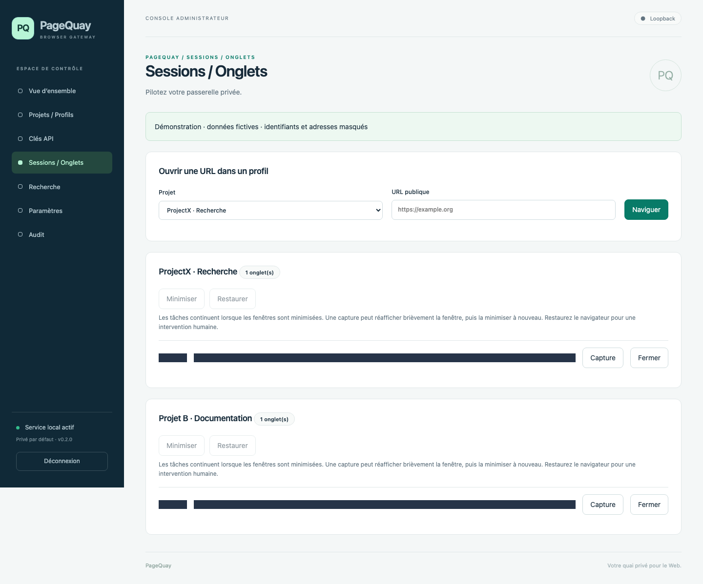

# PageQuay (PQ)

[Français](README.md) | [English](README.en.md)

Private, self-hosted web gateway: each project has its own persistent Chromium profile, tabs, API keys and temporary content. FastAPI REST + WebSocket API and local HTML/CSS/JavaScript administration, with no frontend build, Docker or subscription.

**Version 1.2.0 — opt-in GIF and originals up to 20 MB, without internal Base64.** See the [test report](docs/testing/REPORT.en.md) for executed checks and limitations. Original specifications are in `docs/definition/`; development history is in `memory.md` and `decisions.md`.

## Documentation

Local 1.2.0 release: [notes](docs/releases/1.2.0.en.md). Publication, Dobot acceptance and installation are separate.

The [bilingual documentation index](docs/README.md) lists English and French guides, release notes and validation reports.

| Document | Purpose |
| --- | --- |
| [Current status](docs/STATUS.en.md) | Delivered features, checks and outstanding validation |
| [Architecture](docs/ARCHITECTURE.en.md) | Components, flows, profiles and network controls |
| [Structured extraction](docs/EXTRACTION.en.md) | JSON/DOM contract, examples and limits |
| [Operations](docs/OPERATIONS.en.md) | macOS, LaunchAgent, Tailscale, backups and troubleshooting |
| [Publishing](docs/PUBLISHING.en.md) | Local and public repository synchronization |
| [Security](SECURITY.en.md) | Protections and trust boundaries |
| [Search](docs/SEARCH_API.en.md) | DuckDuckGo continuations, quotas, idempotency and ProjectX client |
| [Navigation and scope](docs/NAVIGATION_SCOPE.en.md) | Redirects, Cloudflare waiting, human resume and scope_changed |
| [Exact acquisition](docs/ACQUISITION.en.md) | URL contracts, robots, evidence, frame diagnostics and server client |
| [Original images](docs/DOWNLOAD_IMAGE.en.md) | download_image and UBTECH validation |
| [KUKA frame fix](docs/KUKA_FRAME_FIX.en.md) | Real-site evidence and regression coverage |
| [OpenAPI](docs/openapi.json) | Shared machine-readable 1.2.0 contract, also served at /openapi.json |

[Release 1.1.0](https://github.com/tmcuh1982/PageQuay/releases/tag/v1.1.0), Python packages and SHA-256 checksums were published on October 16, 2026. Sources and documentation are public on [tmcuh1982/PageQuay](https://github.com/tmcuh1982/PageQuay), branch `main`. Local data and captures are excluded.

## Use and disclaimer of liability

The PageQuay source code and software are provided “as is”, without any warranty of availability, accuracy or fitness for a particular purpose. You use, modify and deploy this code at your own risk.

To the extent permitted by applicable law, the authors and contributors disclaim liability for uses of the source code or software and any resulting damage, including data loss, service interruption or use of content obtained from third parties. Each user is responsible for complying with applicable laws, the terms of the websites accessed, intellectual property rights and personal data protection requirements, and for obtaining necessary permissions. Nothing in this disclaimer excludes or limits liability that cannot lawfully be excluded or limited.

## Interface preview

Demonstration screenshots use fictitious data and masked sensitive fields. [View all eight screenshots](docs/SCREENSHOTS.en.md).



## Third-party project: Pillow

PageQuay uses [Pillow](https://github.com/python-pillow/Pillow), the Python imaging
project maintained by its contributors, to check the structure and decodability
of acquired JPEG, PNG, WebP images and the first image of acquired GIFs. This local validation preserves the original
bytes; its operation and limits are described in the
[original image guide](docs/DOWNLOAD_IMAGE.en.md#third-party-project-pillow).
Pillow is not an antivirus: an accepted image is not guaranteed to be free of
malicious content or risks of exploiting software that opens it.

## macOS installation

Python 3.12–3.14 and [uv](https://docs.astral.sh/uv/) are required for the locked installation. Initial development used Python 3.14 on Apple Silicon.

```sh
git clone https://github.com/tmcuh1982/PageQuay.git
cd PageQuay
./scripts/install_macos.sh
.venv/bin/pq init-admin
./scripts/start.sh
```

The interactive terminal asks for a username and password of at least 14 characters. There is no default administrator or password. Open the [local console](http://127.0.0.1:8765/admin). For an existing checkout, start in its root without cloning again.

The installer installs dependencies and Chromium; `uv.lock` pins Python dependency versions. Without uv it falls back to a venv and `pip install -e '.[dev]'`, which follows pyproject ranges rather than exact locked versions. Each operator must initialize their administrator.

`pq serve` applies SQL migrations at startup, uses one process and binds **only to 127.0.0.1**, on two distinct ports: 8765 for administration and 8766 for the API and optional Tailscale access. Access logs are disabled. Ctrl-C shuts down cleanly and preserves profiles.

For development data inside the checkout:

```sh
export PQ_DATA_DIR="$PWD/.data"
.venv/bin/pq init-admin
./scripts/start.sh
```

Use the same data directory for initialization and startup. `.env` is read from the project root; `.env.example` contains configuration without secrets. The default data directory is `~/Library/Application Support/PageQuay/`, with separate SQLite, `profiles/`, `artifacts/` and `logs/`. Personal Chrome profiles are never reused.

The browser uses an explicit nonzero CDP port on `127.0.0.1`, selected per launch. A local relay preserves Playwright initialization, persistent context, sandbox, filtering proxy, interceptions and Service Worker/download blocking. Playwright's internal pipe ends at the relay; Chrome receives the CDP port. This control port is not exposed through the API and closes with the browser.

Page WebSockets are denied through a native Chrome proxy rule: HTTP/HTTPS use the filtering proxy and `socks=` (Chromium's “other proxies” category, used for ws/wss) points to a second local listener that rejects before DNS. No direct fallback is configured. Frames, popups and workers are covered; JavaScript `WebSocket` stays native. PageQuay's command WebSocket remains available. See [Chromium's rules](https://chromium.googlesource.com/chromium/src/+/HEAD/net/docs/proxy.md#mapping-websockets-urls-to-a-proxy) and [browser transport](docs/BROWSER_TRANSPORT.en.md).

`PQ_BROWSER_CHANNEL=chrome` selects installed Google Chrome; `chromium` is the default Playwright browser, whose executable may be named “Google Chrome for Testing”. See [1.1.0 notes](docs/releases/1.1.0.en.md) and [1.0.1 notes](docs/releases/1.0.1.en.md).

## Usage

1. Create `projectx` and `projet-b` under **Projets / Profils** (Projects / Profiles).
2. Start their independent persistent browsers. Visible mode is the default and requires a logged-in graphical macOS session.
3. Under **Clés API** (API Keys), choose project, permissions and expiration; copy the secret shown once. Initial permissions are `search:read` and `content:read`. Navigation/actions require `browser:interact`, tab lists `browser:read`, and screenshots `screenshot:read`.
4. Use **Recherche** (Search) or **Sessions / Onglets** (Sessions / Tabs). Long operations create jobs whose state and result appear in the console.
5. For a challenge, act manually in Chromium on the Mac and choose **Reprendre** (Resume). No automatic CAPTCHA solving.

The console currently uses French labels; the documentation provides both languages.

Under **Paramètres → Accès local** (Settings → Local access), set distinct administrator and API ports, save, then restart. Occupied or identical ports are rejected; active and pending settings are shown separately. Update clients and any Tailscale Serve destination after changing the API port. `PQ_PORT` and `PQ_API_PORT` provide initial values. [Details](docs/OPERATIONS.en.md#local-administrator-and-api-ports).

Under **Paramètres → Accès externe** (Settings → External access), set **Port HTTPS externe**, then apply. The change is immediate and persistent in Serve; update clients and tailnet access rules. Default 443 is omitted from URLs; 8443 is a convenient alternative, e.g. `https://mac-mini.your-tailnet.ts.net:8443`. Port 8080 can also carry HTTPS when configured accordingly. This setting is global, independent of projects and local ports. Tailscale, Serve/HTTPS and the exact hostname in `PQ_ALLOWED_HOSTS` are required. Occupied/shared/Funnel routes are rejected. [Operations](docs/OPERATIONS.en.md#external-https-port).

**Minimiser / Restaurer** minimizes/restores project browser windows. Remote work continues while minimized; new tabs preserve the state. Screenshots briefly restore the window for rendering, then minimize it again. **Démarrer les fenêtres minimisées** applies on next browser startup, with a per-project `browser_start_minimized` JSON override. Headless mode has no window. Restore before human intervention.

API key requests/minute count operation submission, polling and downloads separately over a fixed 60-second window. Effective quota is the minimum of key and project limits; exceeding it returns 429. Expiration is off by default; **Définir une date d’expiration** enables it, and disabling clears it. **Sans expiration** means no expiration.

**Modifier la sécurité** edits an existing key's name, scopes, quota and expiry without changing its secret or project. Removed permissions cancel dependent jobs; revoked keys cannot be edited. Expired keys can receive a future expiry or no expiry. Cancel preserves current settings. Revocation stops active jobs and WebSockets on revalidation within one second; rotation creates a new secret and immediately revokes the old one. API keys never open administration.

## API v1

All paths below are relative to `/v1/projects/{slug}` and require `Authorization: Bearer <key>` with project/resource checks. Job reads require the original scope; job control is restricted to its creating key or the administrator.

| Method / path | Permission | Result |
| --- | --- | --- |
| GET /key-info | Project key | Own permissions, expiry and effective quota |
| POST /search | search:read | 202 search job |
| POST /download_image | content:read + browser:interact | 202 original image acquisition job |
| POST /tabs | browser:interact | 202 open/navigation job |
| GET /tabs, /tabs/{id} | browser:read | List/state |
| DELETE /tabs/{id} | browser:interact | Close; conflict while active |
| POST /tabs/{id}/navigate, /tabs/{id}/actions | browser:interact | 202 job |
| GET /cookie-policy | browser:read | Project automatic consent choice |
| PUT /cookie-policy | browser:interact | Save automatic consent choice |
| GET /tabs/{id}/content?format=text\|html\|links\|metadata\|structured | content:read | 202 job and temporary artifact |
| GET /tabs/{id}/screenshot | screenshot:read | 202 viewport PNG job |
| GET /artifacts/{id} | Artifact scope | Protected download |
| GET /jobs/{id} | Job scope | State, result or error |
| POST /jobs/{id}/cancel, /resume | Job scope + creating key | Cancel/resume |
| POST /ws-ticket | Project key | Single-use ticket, 30 seconds |
| WS /events | Ticket in first message | Filtered events and bounded commands |

`GET /health/live` and `/health/ready` return minimal state. `/openapi.json` is available on the API port and private HTTPS, excludes administration and matches [the committed schema](docs/openapi.json). `/docs` is restricted to admin transport with `PQ_DEVELOPMENT=true`.

### Calling key information

```sh
curl --fail-with-body http://127.0.0.1:8766/v1/projects/projectx/key-info \
  -H "Authorization: Bearer $PQ_API_KEY"
```

The result includes `key_id`, `name`, nonsecret `prefix`, `project`, `scopes`, nullable `expires_at` and `rate_limit` with `configured_requests_per_minute`, `project_requests_per_minute`, `effective_requests_per_minute`, `window_seconds`, `remaining_requests` and `resets_at`. Use the effective minimum. Remaining requests include this call, polling and downloads; the fixed window starts on the first accepted request. Reset/expiry timestamps are Unix UTC seconds; null expiry means no expiration. The response is a snapshot, not a reservation; exhausted quotas return 429. Edits appear on the next call. Expired/revoked keys return 401; wrong project or disabled project returns 403. No secret/hash is returned. Operation-specific and WebSocket limits also apply. [Python client](examples/key_info.py) uses `PQ_URL`, `PQ_PROJECT`, `PQ_API_KEY`.

### Actions and cookie consent

Actions: `click`, `fill`, `select`, `scroll`, `wait_for_selector`, `wait_for_navigation`, `validate_cookies`. At most 20 actions, with bounded selectors, values and timeouts. `wait_for_navigation` waits for the current navigation's load state; Playwright click waits for its own navigation. Clients cannot supply eval, CDP, shell, uploads or file paths.

```http
POST /v1/projects/{slug}/tabs/{tab_id}/actions
Authorization: Bearer <key>
Content-Type: application/json

{"actions":[{"type":"validate_cookies","value":"reject","timeout_ms":5000}]}
```

`value` is `reject` (default) or `accept`. Optional `selector` identifies the banner container, whose text must concern cookies. A recognized exact button label is required; reject never falls back to accept.

```http
PUT /v1/projects/{slug}/cookie-policy
Authorization: Bearer <key>
Content-Type: application/json

{"choice":"reject","timeout_ms":1500}
```

The persistent project rule defaults to `choice:null` (disabled); accept must be explicit. It applies to API opens/navigation, search/native pagination and after click/wait_for_navigation actions. It is shared across project keys, survives restart and is reread per operation. Saving does not immediately click open tabs or rewrite cookies. Manual navigation and late banners need explicit actions. Automatic waiting is bounded by remaining navigation time; `timeout_ms` accepts 100–10000.

`cookie_consent` is an object for navigation or a list with `action_index` for actions; automatic applications include `automatic:true`. Statuses: `clicked`, `not_found`, `choice_unavailable`, `ambiguous`, `scan_limit`, `timeout`, `unavailable`. `clicked` proves a click, not site persistence. Missing/unrecognized banners do not fail navigation. Choice/status are audited in `function.validate_cookies`.

Detection is bounded to eight frames and 32 containers/buttons per frame, including visible iframes/open Shadow DOM; common French, English, German and Polish labels are recognized. Custom CMPs and multi-screen preferences are not guaranteed. Ambiguity, missing choice or scan limits produce no click. Authorization, challenges and network controls remain active.

### Content, errors and WebSocket

`format=structured` reads the rendered DOM: ordered blocks, nested lists, HTML/ARIA tables, links, images, controls/forms, metadata/JSON-LD and iframe documents. Open Shadow DOM and slots are traversed. `include_dom=true` adds a filtered node tree only for structured format. Hidden content, scripts/styles and input/textarea values are excluded. Explicitly wait, scroll or click before extracting dynamic content again. [Contract](docs/EXTRACTION.en.md), [compact fixture](docs/testing/structured-complex-compact.json), [DOM fixture](docs/testing/structured-complex.json).

Errors use `{"error":{"code":"…","message":"…","request_id":"…"}}`; asynchronous errors appear in jobs. Common codes include `UNAUTHORIZED`, `FORBIDDEN`, `INVALID_INPUT`, `NOT_FOUND`, `RATE_LIMITED`, `NAVIGATION_BLOCKED`, `TIMEOUT`, `BROWSER_CRASHED`, `CHALLENGE_REQUIRED`, `CONFLICT`, `INVALID_CURSOR`, `CURSOR_EXPIRED`, `CURSOR_USED`, `INTERNAL_ERROR`, `UPSTREAM_CHANGED`, `UPSTREAM_UNAVAILABLE`; exact acquisition/image errors are in their guides. Job states: `queued`, `running`, `waiting_for_human`, `completed`, `failed`, `cancelled`. Service restart fails interrupted jobs without replaying actions.

```sh
read -s PQ_API_KEY
export PQ_API_KEY
curl --fail-with-body http://127.0.0.1:8766/v1/projects/projectx/search \
  -H "Authorization: Bearer $PQ_API_KEY" -H 'Content-Type: application/json' \
  -d '{"query":"agricultural robotics","engine":"duckduckgo","limit":5}'
unset PQ_API_KEY
```

Python/WebSocket examples are in `examples/`. Never put keys in URLs. Send `{"ticket":"…"}` within five seconds; a WebSocket lasts at most ten minutes and supports ping/pong, navigation, actions, resume and cancel under REST-equivalent checks.

## Search, retention and audit

DuckDuckGo, Brave and Google have separate fixture-tested adapters. Explicit engines never switch; `auto` permits configured fallback/merge. DuckDuckGo uses an opaque cursor to deliver stored remainder then its native Next form. Default maximum is 10 results/job; set `search_max_results=50` to allow 50. Results expose count, ranks, exact URLs, engines, `next_cursor`, nullable `has_more` and stop reason. Default chain limits: 10 pages, 200 results, 15 minutes. Three native pages are fixture-validated; historical live DuckDuckGo attempts encountered CAPTCHA.

PageQuay's engine quota is **6 page attempts/60 seconds per project/engine**, shared by keys/admin; this is not a DuckDuckGo quota. Stored remainder consumes no engine attempt. REST quotas are separate and include polling. 429 provides `Retry-After` when known; job errors expose scope/cause/timing, resumability and partials. `Idempotency-Key` on POST /search retrieves the same operation for 24 hours, including after restart. Owned internal tabs close on success/failure/cancellation.

DuckDuckGo filters: `region` such as `fr-fr`, `pl-pl`, `us-en`, `wt-wt`; `time_range` in `any`, `day`, `week`, `month`, `year`. Console menus are **Pays / région** and **Période**. Preserve filters across continuations. Explicit filters are rejected for auto/other engines. `fetched_at` is collection time, not publication/event time. Locale transmission does not guarantee rankings. Identifiable ads are filtered; unknown types remain `uncertain`. No CAPTCHA solver, spoofing or identity rotation. [Search contract](docs/SEARCH_API.en.md), [server client](examples/search_duckduckgo.py).

| Policy | Effect |
| --- | --- |
| Content TTL, default 60 minutes | Expires artifacts/job results, preserves cookies |
| Artifact retention, default maximum 24 hours | Shorter TTL wins; per-project disk quota |
| Browser idle, 30 minutes | Closes after draining jobs, preserves profile |
| Soft restart, disabled by default | Reopens same profile after jobs drain |
| Manual hard reset | Short-lived server intent and two confirmations; deletes only that profile |
| Audit, 30 days | Purges audit and old job history |

Maintenance runs every 30 seconds; artifact reads check expiry immediately. **Purger contenus** removes project temporary content without closing the browser. No automatic destructive reset or session snapshot. Sites control cookie validity.

Audit shows visited/resource/destination URLs, encoded response-body sizes (KiB, excluding headers), HTTP statuses and function/job/network duration. Job timing excludes queue and includes human wait; missing historical measurements show “—”. Recognized pagination is labeled **next page**. Filters cover project/type/action/status/date/job; the Job menu lists 200 recent operations. Browser-local dates are used throughout the console; storage/query parameters remain UTC. **last 10 min**, **last hour**, **Today** preserve other filters; Today begins at local midnight. URL queries/fragments are retained verbatim; embedded userinfo is removed. This audit is local-admin-only. Old `[masque]` values cannot be reconstructed; no retroactive detail is invented.

A dedicated bounded worker writes audit data; alerts expose omitted/purged events and write errors. Separate histogram counters retain API totals when detail is omitted; project/key dimensions may be coalesced at capacity. See [resource budgets](docs/OPERATIONS.en.md#resource-budgets).

## Tests and development

```sh
uv sync --frozen --extra dev
.venv/bin/ruff check .
.venv/bin/ruff format --check .
.venv/bin/pytest -q
.venv/bin/pytest tests/test_browser.py tests/test_ui.py --browser --headed -q
.venv/bin/pytest tests/test_structured.py --browser --headed -q
.venv/bin/pytest tests/test_live_search.py --live -q -s
```

Browser tests start test browsers and localhost servers. LAN exceptions are injected only into test dependencies, never configurable in production. Without `--browser`, Chromium tests are skipped. `--live` is an external diagnostic; generated live reports remain local. A passing diagnostic test means the outcome was recorded, not that the engine returned results. See [test report](docs/testing/REPORT.en.md).

For another Mac, run `python3 examples/probe_google.py --url https://HOSTNAME-PQ --project SLUG`. The standard-library client prompts secretly for a key or reads `PQ_API_KEY`; scopes: `search:read`, `browser:interact`, `content:read`. Reports are `pagequay-google-probe.json` and, on success, `.txt`. It stops on challenges and exits 1 on failure. HTTPS or loopback HTTP via SSH only; it installs no service or Serve route.

An existing authorized MacBook Air SSH alias can run a temporary probe:

```sh
ssh macmini-codex 'cat Documents/Codex/PageQuay/examples/probe_via_ssh.py' | python3 - --human
```

Default remote root is `Documents/Codex/PageQuay` relative to SSH home; adapt both cat path and `--remote-root` as needed. The mini needs a GUI session and free loopback port 18766. The client creates an isolated temporary service/profile/key and SSH tunnel, without admin/Serve configuration. With `--human`, act in Chromium on the mini, then type `reprendre` to resume or `annuler` to cancel on the Air. Reports are saved on the Air and copied to `docs/testing/macbook-air-google.json` on the mini, with content `.txt` on success. Cleanup closes tunnel/service; service lifetime is at most 15 minutes. Without `--human`, blocking is reported immediately. The key is passed through SSH/subprocess environment, never printed or placed in arguments. Historical remote execution remained pending; local evidence is in the private `ssh-probe-local.json`.

Both probe clients accept `--format structured` and `--include-dom`; content JSON remains separate from the report.

`src/pagequay/` contains runtime components, templates/assets and packaged SQL migrations. `tests/` contains reproducible validation. SQLite uses no ORM/Alembic; see `decisions.md` for development rationale.

## Operations

See [operations](docs/OPERATIONS.en.md) and [security](SECURITY.en.md). Profiles contain local secrets and are not encrypted by the application. Energy settings, launchd, tunnels and external access are not installed automatically.

References: [persistent contexts](https://playwright.dev/python/docs/api/class-browsertype#browser-type-launch-persistent-context), [Chromium sandbox](https://playwright.dev/python/docs/api/class-browsertype#browser-type-launch-option-chromium-sandbox), [FastAPI WebSockets](https://fastapi.tiangolo.com/advanced/websockets/), [Tailscale Serve](https://tailscale.com/docs/features/tailscale-serve).
