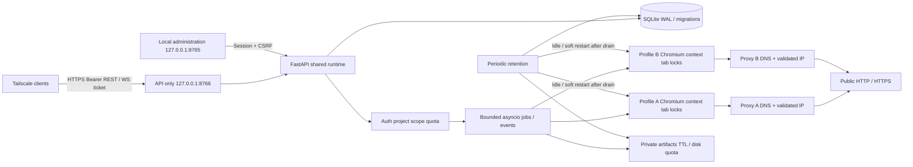

# Components and flows

[Français](ARCHITECTURE.md) | [English](ARCHITECTURE.en.md)

Browser startup preserves BROWSER_CRASHED and adds bounded stage/startup_step/cause/error_class. Raw exceptions/Chromium logs never cross the API. Recognized timeout, missing executable and lock marker are distinct; other causes stay unknown. Cleanup/locks/keys/profiles remain preserved. [Startup diagnostics](STARTUP_DIAGNOSTICS.en.md).

One application process, synchronous SQLite for short transactions, asynchronous Playwright. Argon2 runs in a thread; normal SQLite mutations stay in the application loop. Profiles have interprocess flock, tabs asyncio locks. Job queue is bounded; states persist but actions are never replayed after failure. Two projects can navigate concurrently, one operation per tab.

The proxy resolves/validates addresses then connects to literal IP, complementing Playwright routing for redirects without route callbacks. It does not intercept TLS or replace an OS firewall. Pages/results are escaped/untrusted data; artifact reads always recheck project/scope.

structured.py executes fixed extraction.js read-only in each isolated document. It builds bounded visible-DOM semantic blocks/collections, traverses open shadow roots/slots and adds a filtered tree only with include_dom=true. Iframes are separate ID/parent-linked documents; unavailable frames do not remove main results. No client-supplied script, third-party fetch or automatic action is needed. Scope/challenge/revocation/tab-lock/time/storage controls apply. [Contract](EXTRACTION.en.md).

DuckDuckGo search stores remainder/native Next forms in search_cursors. Random client tokens are hashed for lookup and encode no key/engine parameters. Cursor reservation, job and search_idempotency mapping are inserted atomically without await. Single-process quotas/idempotency are shared; service lock prevents concurrent workers on the same profiles. Search jobs own/close their tab in finally; continuations retain none. Consumed/expired states are removed; idempotency expires after 24 hours. [Search](SEARCH_API.en.md).

## AgXeed export — CHG-20261013-026

URL/title reserve budget before metadata/DOM. Per document: 8000 nodes, min(160000,max_content_bytes/8) characters; 32-frame inventory, four visible reads, global 40 seconds and 10 seconds/frame. Hidden frames do not consume reads. Limits are flagged and incoherent captures denied; isolated reading/scope guard remain. [Extraction](EXTRACTION.en.md), [fix evidence](AGXEED_EXPORT_FIX.en.md).

## Shadow frames and diagnostics — CHG-20261013-028

Frames missing from Window enumeration map to their exact CDP target root via opaque owner IDs. Ambiguous root, changed owner/context or ancestor session is denied. Closed parent DOM is not traversed; known iframe documents stay separate. Visibility precedes scheme checks; visible blob stays denied. Public OpenAPI includes optional bounded stale_candidate_count. [OnRobot](ONROBOT_FRAME_FIX.en.md).

## Browser transport — 0.2.4

cdp_launch.py creates a private per-launch wrapper and relays Playwright's pipe to its child browser's explicit loopback CDP port. Persistent profile/guards stay; Chrome no longer receives remote-debugging-pipe. Wrapper is removed after launch and child closes with transport.

EgressProxy has two loopback listeners: validated public HTTP/HTTPS and pre-DNS WebSocket denial. Native Chromium http/https/socks rules select them without replacing JavaScript WebSocket. Both listeners/handlers close together; startup failure leaves none behind. [Transport evidence](BROWSER_TRANSPORT.en.md).

## Original images — 1.1.0

The owned-tab response handler streams bounded original JPEG/PNG/WebP bytes through CDP, validates them with Pillow, checks exact final URL and publishes a project-scoped artifact with SHA-256. Total job deadline includes queue/human wait; failure removes uncommitted artifacts and closes the owned tab. [Image contract](DOWNLOAD_IMAGE.en.md).
