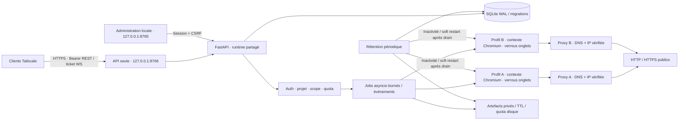

# Composants et flux

Un seul processus applicatif, SQLite synchrone pour transactions courtes et Playwright asynchrone. Le calcul Argon2 est déporté dans un thread ; les mutations SQLite restent dans la boucle applicative. Les profils possèdent un flock interprocessus et les onglets un verrou asyncio. La file de jobs est bornée ; ses états sont persistés, mais les actions ne sont pas rejouées après panne. Deux projets peuvent naviguer simultanément ; une opération par onglet à la fois.

Le proxy résout et valide les adresses puis ouvre une connexion à un littéral IP. La route Playwright ajoute le filtrage applicatif ; le proxy couvre aussi les redirections que le navigateur traite sans rappel de route. Il n'intercepte pas le TLS et n'est pas un firewall OS. Les pages et résultats sont échappés/traités comme données. La récupération des artefacts refait systématiquement le contrôle du projet et du scope.

L'extraction structurée utilise `structured.py` et un script fixe `extraction.js` exécuté en lecture dans chaque document Playwright. Le script construit un snapshot borné du DOM visible, parcourt les racines Shadow DOM ouvertes et les slots, puis produit les blocs et collections sémantiques. L'arbre filtré est ajouté uniquement avec `include_dom=true`. Les documents des iframes sont lus séparément et conservent leurs IDs/parents ; une iframe indisponible ne supprime pas le résultat principal. Aucun JavaScript client, téléchargement tiers ni action automatique n'est nécessaire pour cette extraction. Les quotas d'artefacts, scopes, challenges, révocation, verrou d'onglet et délais de jobs restent appliqués. Contrat et limites : `docs/EXTRACTION.md`.

La recherche DuckDuckGo 0.2 stocke les reliquats/formulaires Next dans `search_cursors`. Le token du client est aléatoire et son hash indexe la table ; il n’encode ni clé API ni paramètres du moteur. Réservation de curseur, ligne de job et association `search_idempotency` sont écrites dans une transaction SQLite sans await. Le processus unique partage les quotas et l’idempotence entre tous ses appels ; le verrou de service interdit les workers concurrents utilisant ces profils. Chaque job possède son onglet interne et le ferme en finally ; les continuations ne retiennent pas d’onglet. Les états consommés/expirés sont effacés et les associations d’idempotence expirent après 24 h. Contrat complet : [SEARCH_API](SEARCH_API.md).
