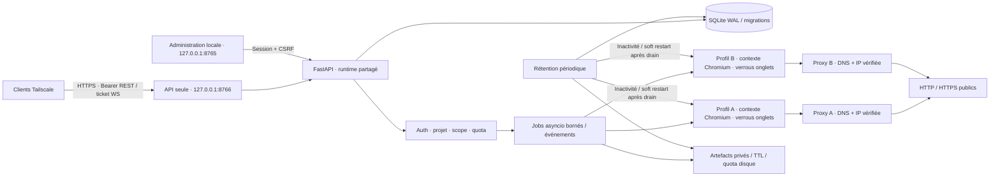

# Composants et flux

Le démarrage du navigateur conserve BROWSER_CRASHED et fournit des diagnostics
bornés stage/startup_step/cause/error_class. Les exceptions et logs Chromium
ne traversent pas l'API ; timeout, exécutable manquant et marqueur de verrou
reconnus sont distincts, les autres causes restent inconnues. Verrous/nettoyage,
clés et profils sont préservés. Voir STARTUP_DIAGNOSTICS.md pour la reproduction
sans profil installé et les limites du diagnostic historique.

Un seul processus applicatif, SQLite synchrone pour transactions courtes et Playwright asynchrone. Le calcul Argon2 est déporté dans un thread ; les mutations SQLite restent dans la boucle applicative. Les profils possèdent un flock interprocessus et les onglets un verrou asyncio. La file de jobs est bornée ; ses états sont persistés, mais les actions ne sont pas rejouées après panne. Deux projets peuvent naviguer simultanément ; une opération par onglet à la fois.

Le proxy résout et valide les adresses puis ouvre une connexion à un littéral IP. La route Playwright ajoute le filtrage applicatif ; le proxy couvre aussi les redirections que le navigateur traite sans rappel de route. Il n'intercepte pas le TLS et n'est pas un firewall OS. Les pages et résultats sont échappés/traités comme données. La récupération des artefacts refait systématiquement le contrôle du projet et du scope.

L'extraction structurée utilise `structured.py` et un script fixe `extraction.js` exécuté en lecture dans chaque document Playwright. Le script construit un snapshot borné du DOM visible, parcourt les racines Shadow DOM ouvertes et les slots, puis produit les blocs et collections sémantiques. L'arbre filtré est ajouté uniquement avec `include_dom=true`. Les documents des iframes sont lus séparément et conservent leurs IDs/parents ; une iframe indisponible ne supprime pas le résultat principal. Aucun JavaScript client, téléchargement tiers ni action automatique n'est nécessaire pour cette extraction. Les quotas d'artefacts, scopes, challenges, révocation, verrou d'onglet et délais de jobs restent appliqués. Contrat et limites : `docs/EXTRACTION.md`.

La recherche DuckDuckGo 0.2 stocke les reliquats/formulaires Next dans `search_cursors`. Le token du client est aléatoire et son hash indexe la table ; il n’encode ni clé API ni paramètres du moteur. Réservation de curseur, ligne de job et association `search_idempotency` sont écrites dans une transaction SQLite sans await. Le processus unique partage les quotas et l’idempotence entre tous ses appels ; le verrou de service interdit les workers concurrents utilisant ces profils. Chaque job possède son onglet interne et le ferme en finally ; les continuations ne retiennent pas d’onglet. Les états consommés/expirés sont effacés et les associations d’idempotence expirent après 24 h. Contrat complet : [SEARCH_API](SEARCH_API.md).

## Export AgXeed — CHG-20261013-026

L’identité URL/titre est réservée avant métadonnées et DOM. Plafonds par document :8 000nœuds, min(160 000,max_content_bytes/8) caractères. Inventaire32frames, quatre lectures visibles, durée globale40s et dix secondes/frame ; frames cachées signalées sans consommer de lecture. Limites atteintes toujours signalées, captures incohérentes refusées. Aucun accès/profil/clé modifié ; lecture isolée et garde de portée inchangées. Voir EXTRACTION.md et AGXEED_EXPORT_FIX.md.

## Frames Shadow et contrat de diagnostic — CHG-20261013-028

Le lecteur associe les frames Shadow non énumérées par Window à la racine de leur cible CDP exacte, via des IDs de propriétaire opaques. Racine ambiguë, propriétaire changé, contexte remplacé ou session d’ancêtre refusés. Le DOM fermé du parent n’est pas parcouru ; les documents iframe connus restent séparés. Contrôle de visibilité avant schéma, blob visible toujours refusé. Contrat OpenAPI régénéré ; compteur de candidats périmés optionnel borné. Aucun accès, profil, clé, quota d’egress ou garde de portée modifié. Voir ONROBOT_FRAME_FIX.md.

## Transport navigateur — 0.2.4

`cdp_launch.py` fournit un wrapper privé par lancement et un relais du pipe Playwright vers le port CDP explicite du seul navigateur enfant. Le contexte persistant conserve son profil et les gardes existantes ; le navigateur ne reçoit plus `--remote-debugging-pipe`. Le wrapper est supprimé après lancement, et le relais ferme l’enfant à la fin du transport.

`EgressProxy` possède deux listeners loopback : HTTP/HTTPS public à DNS/IP validée, et refus des connexions WebSocket avant résolution. La règle native Chromium `http=…;https=…;socks=http://…` affecte les WebSockets au listener de refus, sans injection dans l’objet JavaScript `WebSocket`. Les deux listeners et leurs handlers sont fermés ensemble ; une erreur de lancement ne laisse pas le premier listener ouvert. Contrat REST/WebSocket et schéma public inchangés, hormis la version. Voir [preuves et limites](BROWSER_TRANSPORT.md).
