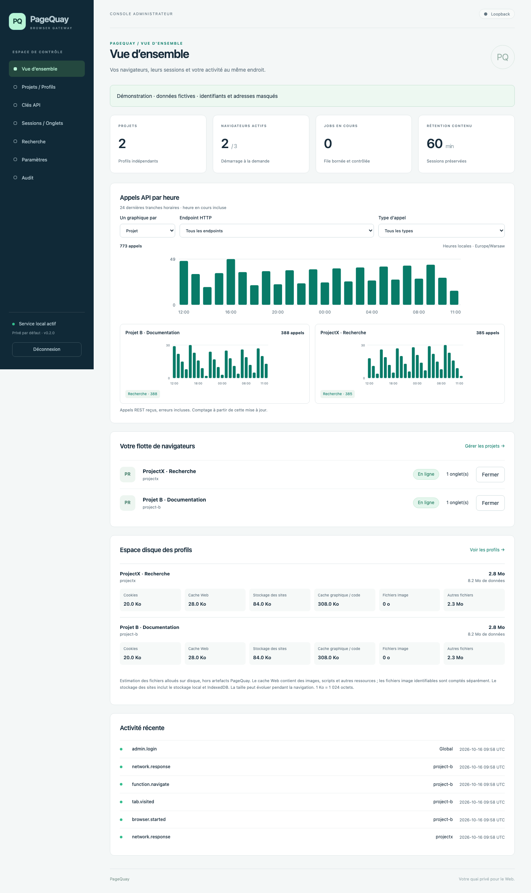
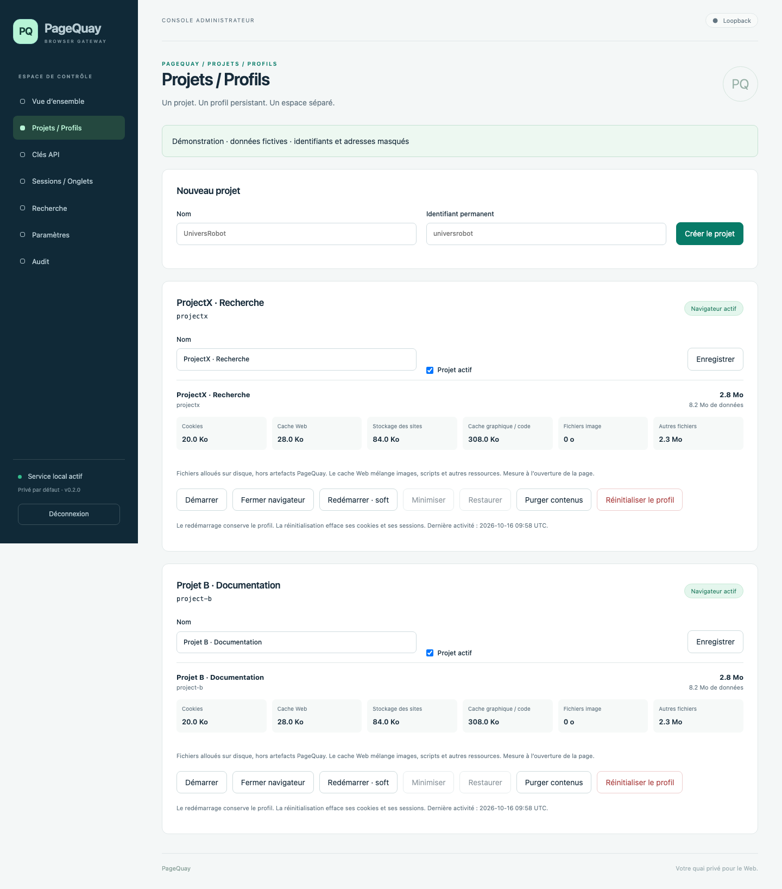
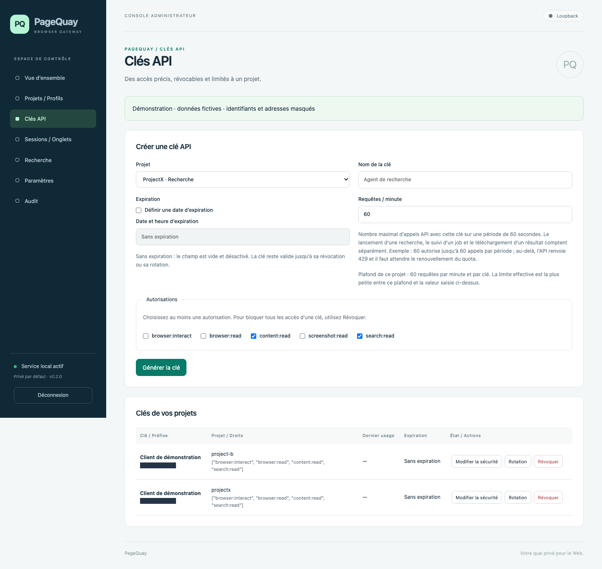
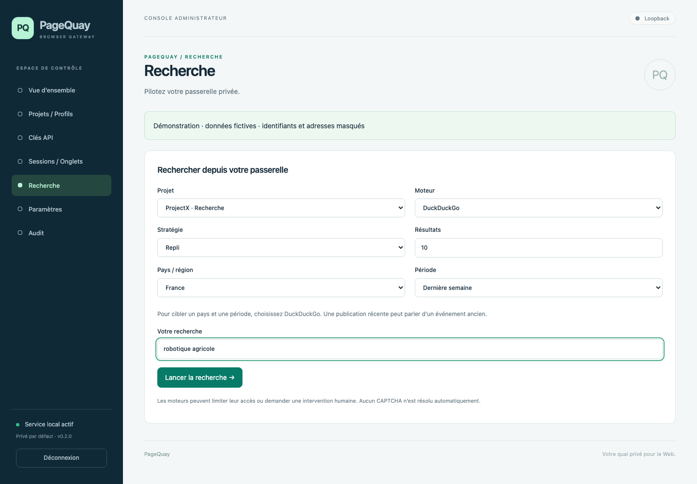
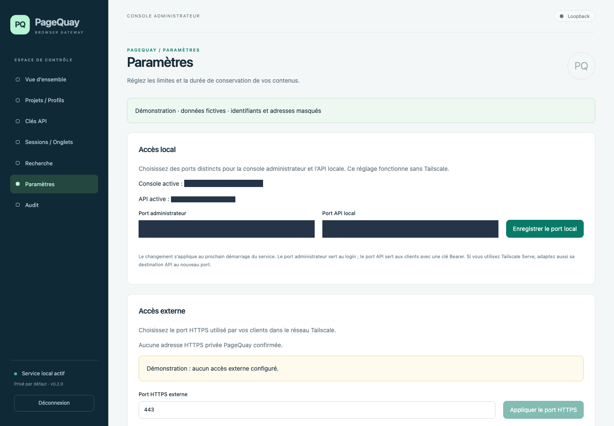
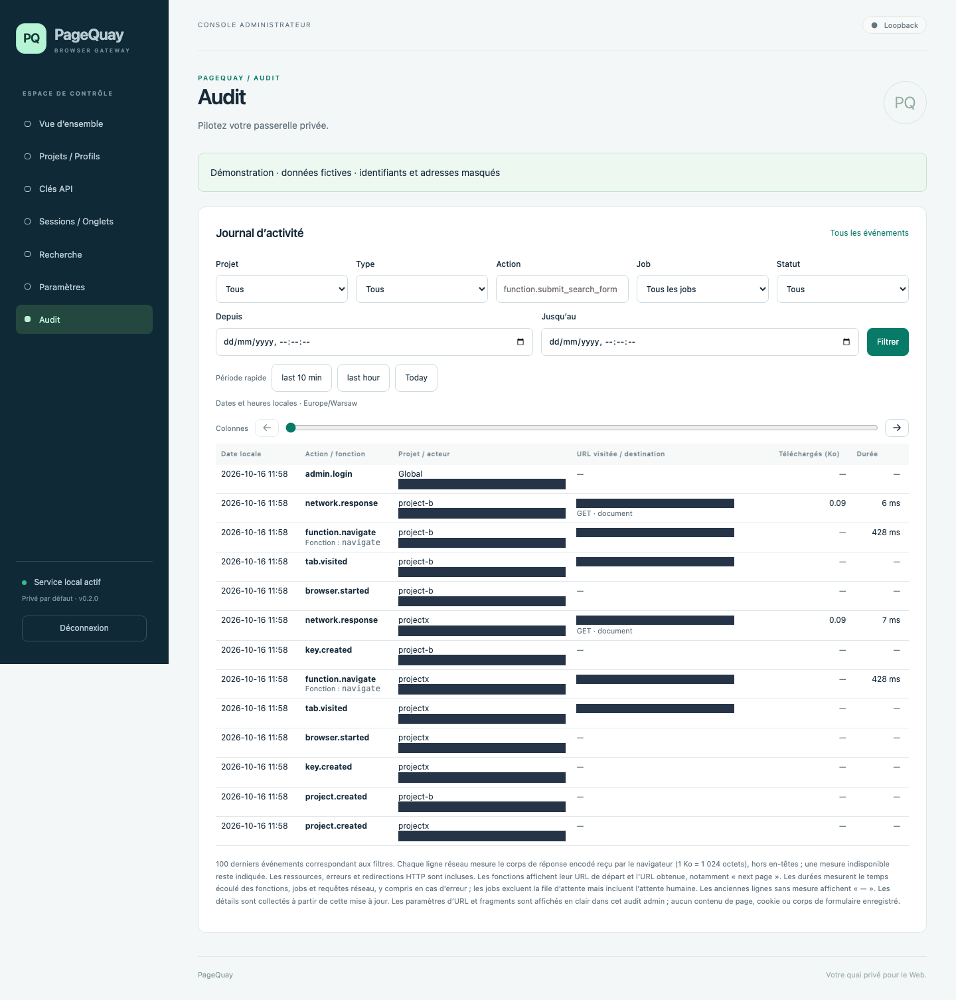
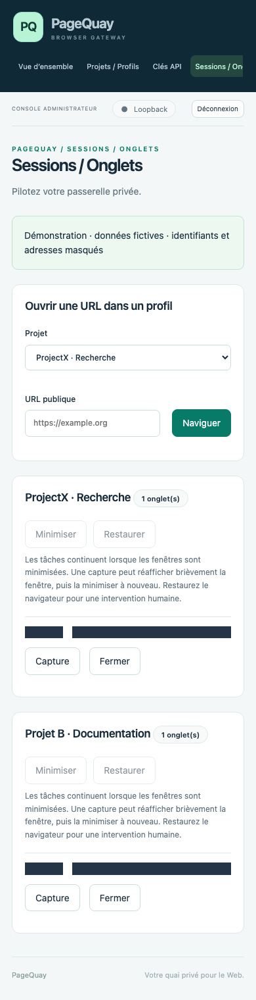

# Captures de l’interface PageQuay

[Français](SCREENSHOTS.md) | [English](SCREENSHOTS.en.md)

Captures du 16 octobre 2026, réalisées avec les sources de PageQuay dans une **instance jetable**, deux projets et des données fictifs. Les graphiques présentent des volumes de démonstration, pas des mesures de production. L’interface est en français.

Les préfixes de clés, identifiants d’onglets, acteurs de l’audit, URL et adresses locales sont masqués par des aplats opaques. Les identifiants de jobs de l’audit sont remplacés dans le document de démonstration avant capture. Aucun service installé, profil personnel, clé existante ou état Tailscale réel n’a été consulté. Les PNG publiés ont été inspectés ; les fichiers de travail, bases, profils et secrets temporaires ne sont pas distribués.

## Vue d’ensemble

Deux profils indépendants, activité API illustrative et espace disque des profils jetables.



## Projets / Profils

Création de projet, gestion du navigateur et séparation des profils.



## Clés API

Autorisations, quotas et expiration. Les secrets complets ne sont jamais affichés et les préfixes sont masqués.



## Sessions / Onglets

Onglets de deux projets, avec identifiants et URL masqués. Les boutons de minimisation sont désactivés ici car les navigateurs de démonstration sont en mode headless.


## Recherche

Formulaire DuckDuckGo avec pays et période. La requête est un exemple non envoyé à un moteur externe.



## Paramètres

Partie supérieure des réglages : ports locaux et accès externe. Adresses et ports locaux masqués ; aucun accès externe configuré dans cette instance.



## Audit

Événements de démonstration et filtres, sans acteurs, URL ou identifiants privés lisibles. Le tableau possède un défilement horizontal ; les colonnes de droite peuvent être hors champ.



## Vue mobile

Sessions / Onglets dans une fenêtre de 390 pixels de large.



## Reproduire les captures

Depuis la racine du dépôt, avec les dépendances de développement et Chromium installés :

```sh
.venv/bin/python scripts/capture_screenshots.py
```

Le script crée une base et des profils temporaires, lance uniquement une instance loopback jetable, génère les PNG et ferme les navigateurs/serveur. Les pages de démonstration sous `example.org` sont servies par interception locale sans récupération externe. L’état Tailscale est fictif ; aucun appel à sa CLI. Le script ajoute un bandeau de démonstration dans les documents capturés et applique les masques avant d’écrire chaque image. Vérifier visuellement les nouvelles captures avant toute publication, notamment après un changement de mise en page.
